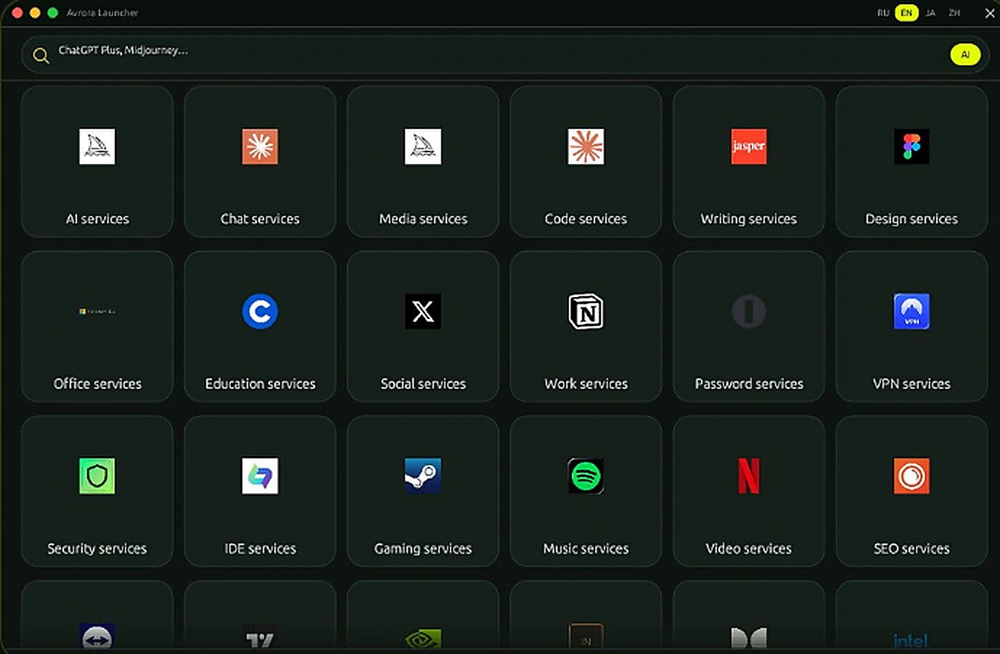

# Quora Plus Free 2026 — ad-free reading and Plus creator answers

> **Quora is paid everywhere. In our Aivora launcher the same paid Plus version is free.**
>
> Official site / app store = paid Plus subscription. Aivora launcher = that paid Plus product, free on Windows 10 / 11.

**Keywords:** Quora+ · Quora Plus free · Quora windows · ad-free · creator answers · paid Quora free through launcher · Aivora Programs

Windows 10 / 11 · Quora Plus · Social premium

The orange button opens [https://aivoraprograms.com/](https://aivoraprograms.com/). Install Aivora, then **Activate** **Quora**. You get the **paid Plus** product **for free in our launcher**. No `Quora.exe` in this repository.

## What Quora is

Quora+ is the paid reading SKU: **ad-free**, **Plus creator answers**, download answers, extra dark-mode tools. The Aivora card is **Plus**, not the free ad-supported feed. This is not Medium Membership and not Reddit Premium.

**Quora is paid everywhere else.** Official access is a Plus subscription. In **our Aivora launcher** that same paid Plus is **free** on Windows 10 / 11. No vendor account. No credit card.

## ad-free reading and Plus creator answers

Plus answers are the paywall extra. Ad-free is the read extra. After **Activate**, open Quora from social premium. This repo has no answer dump.

## Who this Windows page is for

Searches **Quora+**, **Quora Plus windows**, **Quora Plus free** wanting **paid Plus**.

## What the Plus card includes

| Feature | Official Quora | In our Aivora launcher |
|---------|--------------|------------------------|
| Price | Paid Plus subscription | **Free** (same paid Plus) |
| **Ad-free experience** | Plus | Same paid Plus, free here |
| **Plus creator answers** | Plus | Same paid Plus, free here |
| **Download answers** | Plus | Same paid Plus, free here |

## How to open paid Quora on Windows

1. Open [https://aivoraprograms.com/](https://aivoraprograms.com/)
2. Download **Aivora Launcher**
3. Install on **Windows 10** or **Windows 11** (64-bit)
4. Open **Social premium**
5. Find **Quora** and press **Activate**

Paid Quora Plus — **free in our launcher**, paid on the official site.

## Search queries this page covers

- **Quora+**
- **Quora Plus free**
- **Quora windows**
- **ad-free**
- **paid Quora free through launcher**

## Screenshots

Aivora launcher hub — **Social premium** → **Quora**:

## FAQ

**Is this Medium?**  
No. Medium Membership is a different Aivora card. This tile is Quora+.

**Where is the download?**  
[https://aivoraprograms.com/](https://aivoraprograms.com/)

**Is Quora paid or free?**  
Paid everywhere (official Plus). **Free in our Aivora launcher** — same paid Plus version.

**Do I need a Quora account?**  
No. **Activate** on the tile.

---

## На русском

# Quora Plus бесплатно 2026 — чтение без рекламы и ответы Plus-авторов

> **Везде Quora платный. В нашем лаунчере Aivora та же платная версия Plus — бесплатно.**
>
> Официальный сайт / магазин = платная подписка Plus. Лаунчер Aivora = этот же платный Plus, бесплатно на Windows 10 / 11.

**Ключевые слова:** Quora+ · Quora Plus бесплатно · Quora windows · без рекламы · ответы авторов · платный Quora бесплатно через лаунчер · Aivora Programs

Оранжевая кнопка — главная Aivora. Лаунчер → **Соцсети премиум** → **Quora** → **Активировать**. Это **платный Plus**, у нас в лаунчере **бесплатно**.

Quora+ — платное чтение: **без рекламы**, **ответы Plus-авторов**, скачивание ответов. Карточка Aivora — **Plus**, не free с рекламой. Это не Medium и не Reddit Premium.

**Quora везде платный.** Официально подписка Plus. **В нашем лаунчере Aivora** та же платная Plus-версия — **бесплатно** на Windows 10 / 11.

Plus-ответы — paywall. Без рекламы — чтение. Дампа ответов в git нет.

Запросы **Quora+**, **Quora бесплатно** — нужен **платный Plus**.

| Функция | Официально | В нашем лаунчере Aivora |
|---------|------------|-------------------------|
| Цена | Платная подписка Plus | **Бесплатно** (тот же Plus) |
| **Без рекламы** | Plus | Та же платная Plus, у нас бесплатно |
| **Ответы Plus-авторов** | Plus | Та же платная Plus, у нас бесплатно |
| **Скачивание ответов** | Plus | Та же платная Plus, у нас бесплатно |

Как открыть: [https://aivoraprograms.com/](https://aivoraprograms.com/) → лаунчер → **Соцсети премиум** → **Quora** → **Активировать**.

**Это Medium?**  
Нет. Medium — другая карточка. Здесь Quora+.

Quora — товарный знак Quora, Inc.. Страница описывает доступ через Aivora Programs.

[https://aivoraprograms.com](https://aivoraprograms.com/) · hello@aivora.app

#windows11 #windows10 #quora #reading #aivora

---

*Quora+ · Quora Plus free · Quora windows · ad-free · creator answers · paid Quora free through launcher · Aivora Programs · paid Quora free through launcher · Aivora Programs · https://aivoraprograms.com/programs/quora-plus/*
